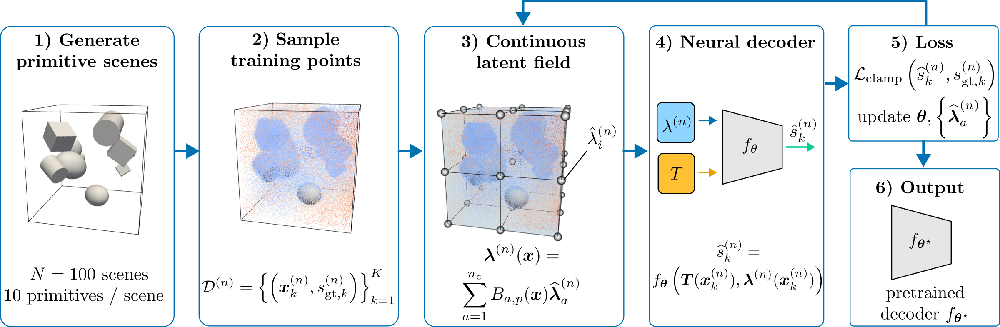
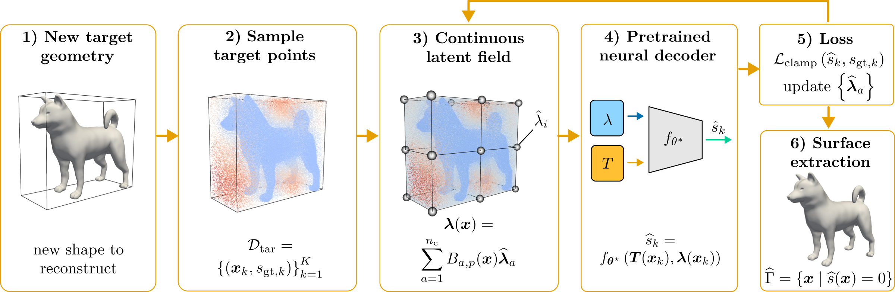

# Improving Neural Shape Representations with Local Latent Fields

**Project type**: Bring your own method

## 1. Motivation and Baseline

Many engineering workflows require a compact representation of shapes. One example is numerical shape optimization, such as minimizing the drag of a body in a flow in aerospace applications.
The use of neural signed distance functions (SDFs) is a promising approach for these kinds of problems.
Ideally, the representation of geometry should:

* represent different shapes using few variables,

* reproduce sharp features (edges and corners) as well as smooth regions,

* generalize to new shapes without retraining the network.

As part of my doctoral studies, in a previous work [\[1\]](https://www.aimsciences.org/article/doi/10.3934/acse.2026013), we proposed a representation with the following components:

* Latent field: Latent control vectors are placed on a fixed lattice in space and interpolated into a continuous latent vector field.

* Decoder: A DeepSDF-style ReLU multilayer perceptron (MLP) [\[2\]](https://ieeexplore.ieee.org/document/8954065) maps a local latent code and local coordinates to an SDF value.

* Training: The decoder is trained once on generated scenes of simple primitive shapes (spheres, boxes, cylinders).

* Reconstruction: A previously unseen shape is reconstructed by optimizing only its latent control vectors.

*Figure 1: Training of the baseline. The decoder and the latent control vectors of all
training scenes are optimized jointly; afterwards the decoder is frozen.*

*Figure 2: Reconstruction of a new shape with the baseline.
Only the latent control vectors are fitted; the surface is the zero level set of the predicted SDF.*

**This geometry representation method should serve as the baseline for this project.** The central question is how the baseline method can be modified to improve the accuracy of the shape representation. To keep the experimental scope manageable, all experiments are conducted in **2D**.

## 2. Project Idea and Approach

The objective is to improve reconstruction quality without increasing the number of latent variables. Two modifications of the baseline will be studied:

| #  | Variant                     | What changes                                                           |
| -- | --------------------------- | ---------------------------------------------------------------------- |
| V0 | **Baseline**                | fixed regular lattice, ReLU MLP decoder                                |
| V1 | **Quantum Decoder (QML)**   | the decoder is a variational quantum circuit with *data re-uploading*  |
| V2 | **Network-Adapted Lattice** | the lattice nodes move, driven by the latent codes and the MLP decoder |

Smaller improvements, such as other activation functions, decoder size, or learning-rate
schedules, are explored as part of the fine-tuning (Assignment 2) and applied to all
variants.

**V1: Quantum Decoder**

This variant is inspired by Quantum Visual Fields [\[3\]](https://4dqv.mpi-inf.mpg.de/QVF/), which demonstrates quantum-based representations of 3D signed distance fields. Here, the classical MLP decoder is replaced with a variational quantum circuit. The local latent code and local coordinates are encoded as rotation angles and re-uploaded across circuit layers. A measured expectation value is linearly rescaled to predict the SDF. The circuit uses a small number of qubits, is simulated in PyTorch, and is compared against the baseline and a parameter-matched classical MLP.

**V2: Network-Adapted Lattice**

In the baseline, the lattice is fixed and regular. Here, each node's displacement is predicted from its own latent code by a small learned map, trained jointly with the decoder. The latent field and the geometric map share the same interpolation basis, so the mapping is isoparametric. The expected benefit is that the lattice aligns with features of the shape, so latent variables are spent where the geometry needs them.

## 3. Datasets

| Purpose              | Data                                                                                                                                                                                          | Source                 |
| -------------------- | --------------------------------------------------------------------------------------------------------------------------------------------------------------------------------------------- | ---------------------- |
| Training             | Self-generated 2D scenes of primitives (polygons, ellipses, their unions and differences) with analytic SDF values                                                                            | generated (as in \[1]) |
| Test (unseen shapes) | [MPEG-7 CE-Shape-1](https://cis.temple.edu/~latecki/TestData/mpeg7shapeB.tar.gz): 1400 binary silhouettes in 70 classes; a fixed subset of 70 shapes (one per class) converted to SDF samples | public                 |

## 4. Error Metric and Target

* **Metric:** Mean Chamfer distance between the reconstructed and the target contour over the
  MPEG-7 test subset, at a fixed budget of latent variables. The budget is the same for all
  variants.

* **Secondary metrics:**

  * IoU (Intersection over Union) of the inside regions,

  * number of disconnected components.

* **Target:** at least **20% lower Chamfer distance than the baseline** at equal budget for the
  best variant. In addition, error-vs-variables curves for all variants.

## 5. Work Breakdown Structure

| #         | Task                                                                                                                             | Hours  |
| --------- | -------------------------------------------------------------------------------------------------------------------------------- | ------ |
| 1         | **Dataset collection:** primitive scene generator; converting MPEG-7 subset to SDF samples                                       | 6      |
| 2         | **Network design and implementation:** baseline                                                                                  | 4      |
| 3         | **Network design and implementation:** quantum decoder                                                                           | 10     |
| 4         | **Network design and implementation:** network-adapted lattice                                                                   | 10     |
| 5         | **Training and fine-tuning:** all variants                                                                                       | 8      |
| 6         | **Evaluation:** reconstruction benchmark, error-vs-variables curves, figures                                                     | 3      |
| 7         | **Application:** Choose a shape, a variant, and a variable budget; show the reconstruction, lattice, and error map side by side. | 4      |
| 8         | **Final report and presentation**                                                                                                | 10     |
| **Total** |                                                                                                                             | **55** |

## References

[\[1\]](https://www.aimsciences.org/article/doi/10.3934/acse.2026013) L. Freinberger, K. Key, M. Kofler, D. Breinl, W\.-G. Drossel, M. Büttner, K. Roder, S. Elgeti.
*Shape optimization using a neural implicit geometry representation.* Advances in Computational
Science and Engineering 9 (2026), 97–124. doi:10.3934/acse.2026013

[\[2\]](https://ieeexplore.ieee.org/document/8954065) J. J. Park, P. Florence, J. Straub, R. Newcombe, S. Lovegrove. *DeepSDF: Learning Continuous Signed
Distance Functions for Shape Representation.* CVPR 2019.

[\[3\]](https://4dqv.mpi-inf.mpg.de/QVF/) S. Wang, C. Theobalt, V. Golyanik. *Quantum Visual Fields with Neural Amplitude Encoding.* NeurIPS 2025.
